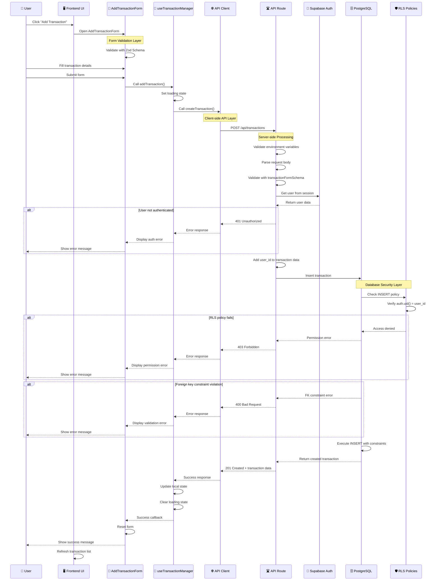
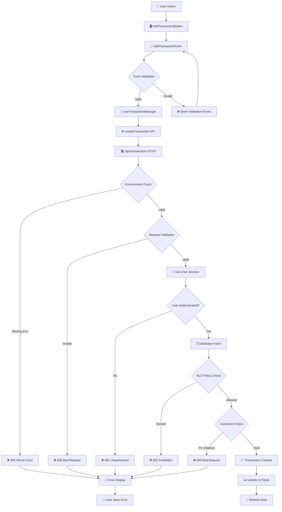
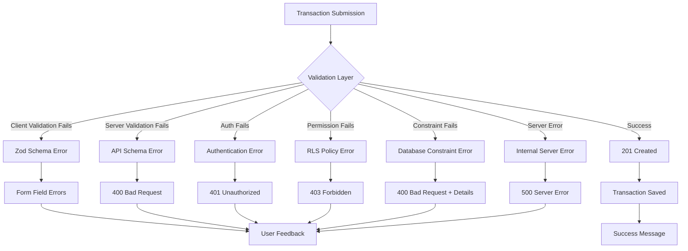
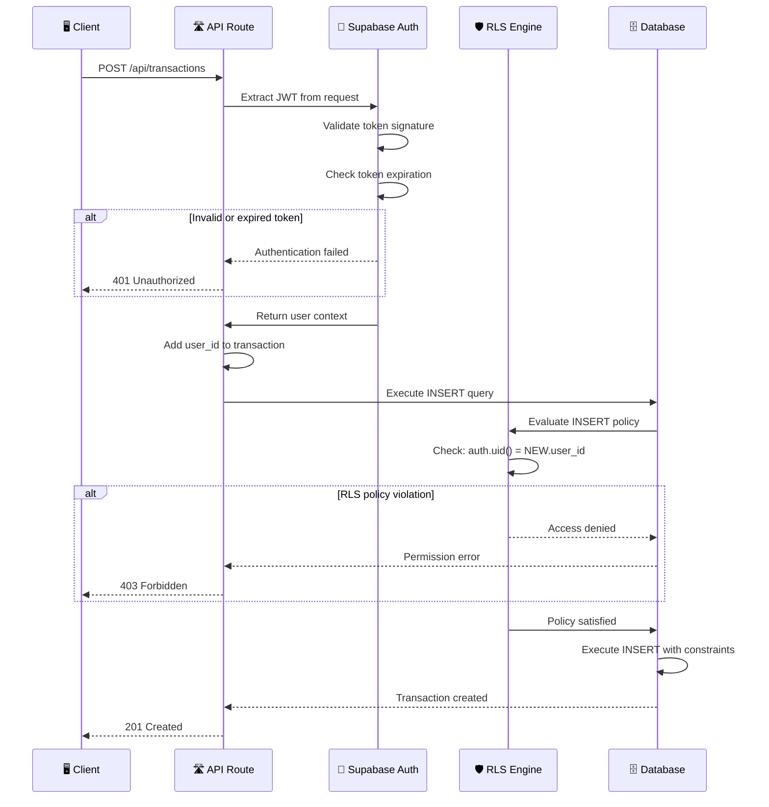
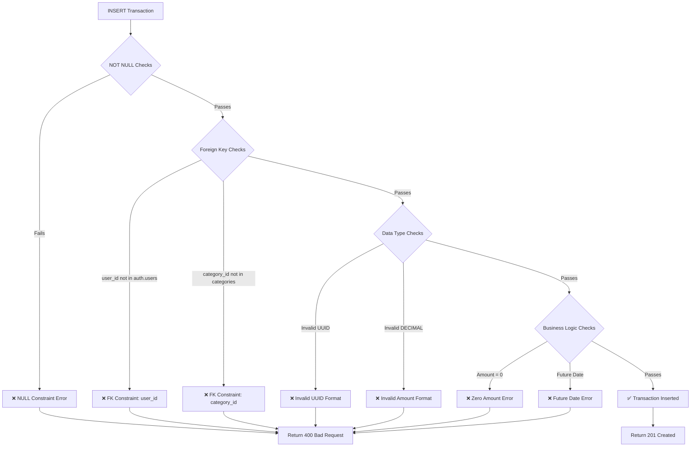
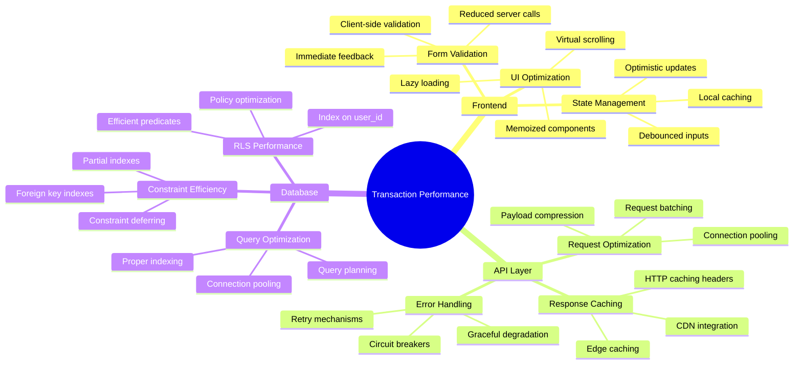
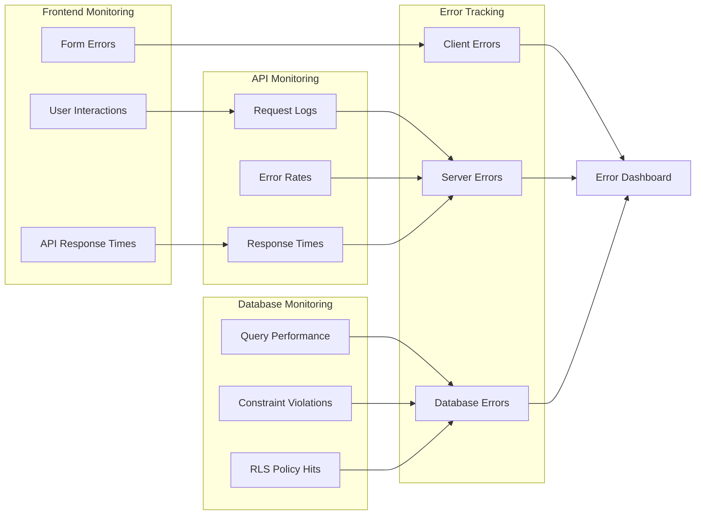

# Transaction Creation Workflow Diagram

## Complete System Flow Visualization



## Component Interaction Flow



## Data Flow Architecture

```mermaid
flowchart LR
    subgraph "Frontend Layer"
        A[AddTransactionForm]
        B[useTransactionManager]
        C[Transaction State]
    end
    
    subgraph "API Layer"
        D[createTransaction]
        E[/api/transactions]
    end
    
    subgraph "Authentication"
        F[Supabase Auth]
        G[JWT Token]
        H[User Session]
    end
    
    subgraph "Database Layer"
        I[PostgreSQL]
        J[RLS Policies]
        K[Foreign Keys]
        L[Constraints]
    end
    
    A -->|Form Data| B
    B -->|API Call| D
    D -->|HTTP POST| E
    E -->|Verify| F
    F -->|Return| G
    G -->|Session| H
    E -->|Insert| I
    I -->|Check| J
    I -->|Validate| K
    I -->|Enforce| L
    I -->|Result| E
    E -->|Response| D
    D -->|Update| C
    C -->|Render| A
```

## Error Handling Flow



## Security & Authorization Flow



## Database Constraint Validation



## Performance & Optimization Points



## Monitoring & Debugging Points



## Key Integration Points

### 1. Frontend ↔ API Integration
- **Request Format**: JSON with specific schema validation
- **Authentication**: JWT token in Authorization header
- **Error Handling**: Structured error responses with specific codes
- **State Management**: Optimistic updates with rollback on failure

### 2. API ↔ Database Integration
- **Connection**: Supabase client with service role key
- **Security**: RLS policies enforced at database level
- **Transactions**: ACID compliance for data integrity
- **Constraints**: Foreign key relationships maintained

### 3. Authentication Integration
- **Session Management**: Supabase Auth handles JWT lifecycle
- **User Context**: Extracted from token and injected into queries
- **Permission Model**: RLS policies based on authenticated user ID
- **Security**: Token validation and expiration handling

### 4. Error Propagation Chain
1. **Database Errors** → Constraint violations, RLS denials
2. **API Errors** → Validation failures, authentication issues
3. **Client Errors** → Network issues, form validation
4. **User Feedback** → Contextual error messages and recovery options

This comprehensive workflow diagram illustrates the complete transaction creation process, highlighting all system interactions, security checkpoints, and potential failure points in the MoneyFlow application.