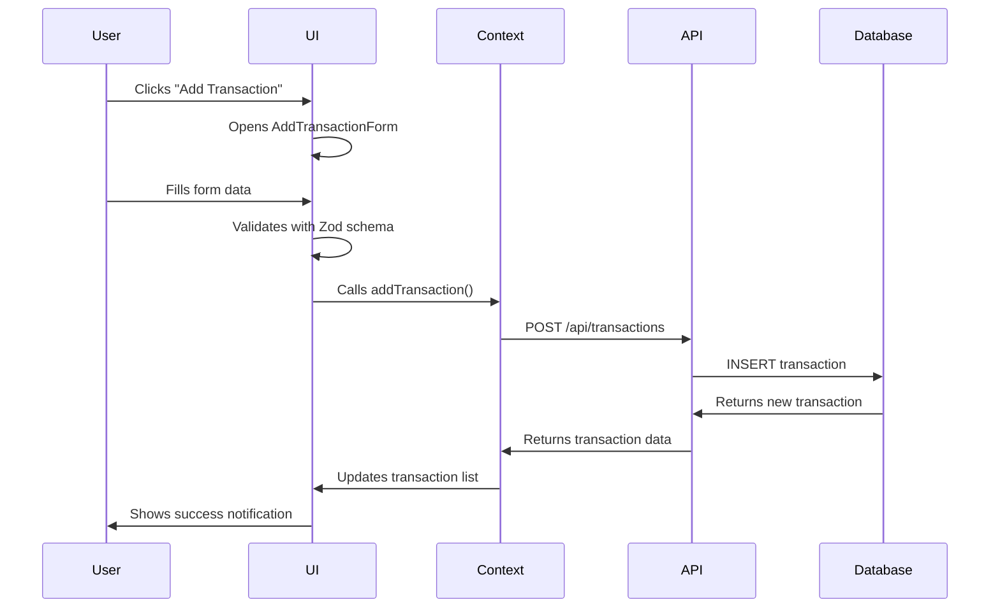

# MoneyFlow App Structures

A comprehensive guide to understanding the MoneyFlow personal finance application architecture, data flow, and component organization.

## 🏗️ Project Architecture Overview

The MoneyFlow app is built using a modern full-stack architecture with the following key technologies:

- **Frontend**: Next.js 15 with TypeScript, React 19
- **Backend**: Next.js API Routes + Supabase
- **Database**: PostgreSQL (via Supabase)
- **Authentication**: Supabase Auth
- **UI Framework**: Tailwind CSS + Shadcn/ui
- **State Management**: React Context + Zustand
- **Form Handling**: React Hook Form + Zod validation

## 📁 Project Structure

```
moneyflow-app/
├── app/                          # Next.js App Router pages
│   ├── layout.tsx               # Root layout wrapper
│   ├── page.tsx                 # Dashboard homepage
│   ├── globals.css              # Global styles
│   ├── api/                     # Backend API routes
│   │   ├── transactions/        # Transaction CRUD operations
│   │   ├── categories/          # Category management
│   │   └── category-groups/     # Category group management
│   ├── spending/                # Spending analysis pages
│   │   ├── page.tsx            # Spending overview
│   │   ├── breakdown/          # Spending breakdown
│   │   └── transaction/        # Transaction management
│   ├── portfolio/               # Investment portfolio pages
│   ├── invest/                  # Investment tools
│   ├── advice/                  # Financial advice
│   ├── tax/                     # Tax planning
│   ├── equity/                  # Equity management
│   └── estate-planning/         # Estate planning tools
├── components/                   # Reusable UI components
│   ├── ui/                      # Shadcn/ui base components
│   ├── LayoutWrapper.tsx        # Main layout container
│   ├── PageLayout.tsx           # Page layout components
│   ├── SideNavigation.tsx       # Left sidebar navigation
│   ├── TopNavigation.tsx        # Top navigation bar
│   ├── AddTransactionForm.tsx   # Transaction creation form
│   ├── EditTransactionForm.tsx  # Transaction editing form
│   ├── TransactionTable.tsx     # Transaction list display
│   ├── CategoryManager.tsx      # Category management
│   ├── BudgetManager.tsx        # Budget management
│   ├── MonthlyChart.tsx         # Monthly spending charts
│   ├── SpendingChart.tsx        # Spending visualization
│   ├── CashFlowBreakdown.tsx    # Cash flow analysis
│   ├── SummaryCards.tsx         # Dashboard summary cards
│   └── NetWorthCard.tsx         # Net worth display
├── contexts/                     # React Context providers
│   ├── TransactionContext.tsx   # Transaction state management
│   └── CategoryContext.tsx      # Category state management
├── hooks/                        # Custom React hooks
│   ├── use-transaction-manager.tsx
│   ├── use-category-manager.tsx
│   ├── use-budget-manager.tsx
│   └── use-mobile.tsx
├── lib/                          # Utility libraries
│   ├── api/                     # API client functions
│   │   ├── transactions.ts      # Transaction API calls
│   │   ├── categories.ts        # Category API calls
│   │   ├── category-groups.ts   # Category group API calls
│   │   └── user-preferences.ts  # User preferences API
│   ├── supabase.ts              # Supabase client configuration
│   ├── data-utils.ts            # Data processing utilities
│   ├── utils.ts                 # General utility functions
│   ├── validations.ts           # Zod validation schemas
│   └── mock-data.ts             # Mock data for development
├── types/                        # TypeScript type definitions
│   ├── database.ts              # Database schema types
│   └── app.ts                   # Application-specific types
├── supabase/                     # Supabase configuration
│   └── migrations/              # Database migration files
├── scripts/                      # Development and testing scripts
│   ├── test-api-endpoints.sh    # API testing script
│   ├── quick-api-test.sh        # Quick API testing
│   └── database-setup.sql       # Database setup script
└── public/                       # Static assets
```

## 🔄 Data Flow Architecture

### 1. User Interaction Flow



### 2. Component Hierarchy

```
RootLayout (app/layout.tsx)
└── LayoutWrapper
    ├── AppSidebar (Navigation)
    └── SidebarInset
        ├── Header (TopNavigation)
        └── PageContent
            └── PageLayout
                ├── TopContent (Full-width)
                └── ContentWrapper
                    ├── MainContent (80% width)
                    └── SideContent (20% width)
```

## 🗄️ Database Schema

### Core Tables

#### 1. Transactions Table
```sql
transactions {
  id: UUID (Primary Key)
  user_id: UUID (Foreign Key)
  date: DATE
  description: TEXT
  amount: DECIMAL
  type: ENUM('INCOME', 'EXPENSE', 'TRANSFER')
  category_id: UUID (Foreign Key)
  merchant: TEXT (Optional)
  notes: TEXT (Optional)
  tags: TEXT[] (Optional)
  created_at: TIMESTAMP
  updated_at: TIMESTAMP
}
```

#### 2. Categories Table
```sql
categories {
  id: UUID (Primary Key)
  user_id: UUID (Foreign Key)
  name: TEXT
  color: TEXT
  group_type: ENUM('EXPENSE', 'INCOME', 'TRANSFER')
  category_group_id: UUID (Foreign Key)
  is_custom: BOOLEAN
  is_active: BOOLEAN
  created_at: TIMESTAMP
  updated_at: TIMESTAMP
}
```

#### 3. Category Groups Table
```sql
category_groups {
  id: UUID (Primary Key)
  user_id: UUID (Foreign Key)
  name: TEXT
  type: ENUM('EXPENSE', 'INCOME', 'TRANSFER', 'CUSTOM')
  color: TEXT
  icon: TEXT (Optional)
  is_default: BOOLEAN
  is_active: BOOLEAN
  sort_order: INTEGER
  created_at: TIMESTAMP
  updated_at: TIMESTAMP
}
```

#### 4. User Preferences Table
```sql
user_preferences {
  id: UUID (Primary Key)
  user_id: UUID (Foreign Key)
  preference_key: TEXT
  preference_value: JSONB
  created_at: TIMESTAMP
  updated_at: TIMESTAMP
}
```

## 🔌 API Endpoints

### Transaction Endpoints

| Method | Endpoint | Description | Parameters |
|--------|----------|-------------|------------|
| GET | `/api/transactions` | Get user transactions | `userId`, `startDate?`, `endDate?`, `categoryId?` |
| POST | `/api/transactions` | Create new transaction | Transaction data in body |
| PUT | `/api/transactions` | Update transaction | `transactionId` + update data |
| DELETE | `/api/transactions` | Delete transaction | `transactionId` |

### Category Endpoints

| Method | Endpoint | Description | Parameters |
|--------|----------|-------------|------------|
| GET | `/api/categories` | Get user categories | `userId` or `categoryId` |
| POST | `/api/categories` | Create new category | Category data in body |
| PUT | `/api/categories` | Update category | `categoryId` + update data |
| DELETE | `/api/categories` | Delete category | `categoryId` |

### Category Group Endpoints

| Method | Endpoint | Description | Parameters |
|--------|----------|-------------|------------|
| GET | `/api/category-groups` | Get category groups | `userId` |
| POST | `/api/category-groups` | Create category group | Group data in body |
| PUT | `/api/category-groups` | Update category group | `groupId` + update data |
| DELETE | `/api/category-groups` | Delete category group | `groupId` |

### Budget Endpoints

| Method | Endpoint | Description | Parameters |
|--------|----------|-------------|------------|
| GET | `/api/budget` | Get user budget | `userId` |
| POST | `/api/budget` | Create new budget | Budget data in body |
| PUT | `/api/budget` | Update budget | `budgetId` + update data |
| DELETE | `/api/budget` | Delete budget | `budgetId` |

## 🎯 Key Components Explained

### 1. LayoutWrapper Component
- **Purpose**: Main application shell
- **Features**: Sidebar navigation, top header, responsive design
- **Location**: `components/LayoutWrapper.tsx`
- **Dependencies**: Shadcn/ui sidebar components

### 2. TransactionContext
- **Purpose**: Global transaction state management
- **Features**: CRUD operations, caching, error handling
- **Location**: `contexts/TransactionContext.tsx`
- **Methods**: `addTransaction()`, `editTransaction()`, `removeTransaction()`

### 3. AddTransactionForm
- **Purpose**: Transaction creation interface
- **Features**: Form validation, category selection, real-time validation
- **Location**: `components/AddTransactionForm.tsx`
- **Validation**: Zod schema validation

### 4. Data Utilities
- **Purpose**: Data processing and formatting
- **Location**: `lib/data-utils.ts`
- **Functions**:
  - `formatCurrency()`: Format numbers as Indonesian Rupiah
  - `getCategoryBreakdown()`: Calculate spending by category
  - `getMonthlyData()`: Generate monthly spending/income data
  - `getMonthlySpending()`: Calculate current month spending
  - `getMonthlyIncome()`: Calculate current month income

## 🔐 Authentication & Security

### Supabase Authentication 
- **JWT Tokens**: Secure session management
- **Row Level Security (RLS)**: Database-level access control
- **Client Types**:
  - `createClientComponentClient()`: For client-side components
  - `createServerComponentClient()`: For API routes and server components

### Security Features
- User data isolation through RLS policies
- Environment variable validation
- Input validation with Zod schemas
- CSRF protection through Next.js

## 🎨 UI/UX Design System

### Layout System
- **Responsive Grid**: Mobile-first design
- **Sidebar**: Collapsible navigation (15% width desktop, collapsible mobile)
- **Content Area**: 85% width with flexible layout
- **Card System**: Consistent padding, shadows, and spacing

### Component Library
- **Base**: Shadcn/ui components
- **Styling**: Tailwind CSS utility classes
- **Theme**: CSS variables for consistent theming
- **Icons**: Lucide React icon library

### Page Layout Structure
```tsx
<PageLayout>
  <TopContent>
    {/* Full-width header content */}
  </TopContent>
  <ContentWrapper>
    <MainContent>
      {/* Primary content (80% width) */}
    </MainContent>
    <SideContent>
      {/* Secondary content (20% width) */}
    </SideContent>
  </ContentWrapper>
</PageLayout>
```

## 🚀 Development Workflow

### Getting Started
1. **Install Dependencies**: `npm install`
2. **Setup Environment**: Configure `.env.local` with Supabase credentials
3. **Run Development Server**: `npm run dev`
4. **Access Application**: `http://localhost:3000`

### Testing
- **API Testing**: Use `scripts/test-api-endpoints.sh`
- **Quick Testing**: Use `scripts/quick-api-test.sh`
- **Manual Testing**: Browser developer tools

### Database Management
- **Migrations**: Located in `supabase/migrations/`
- **Setup Scripts**: Available in `scripts/` directory
- **Schema Updates**: Version-controlled migration files

## 📊 Data Processing Flow

### Transaction Processing
1. **Input Validation**: Zod schema validation
2. **API Processing**: Next.js API route handling
3. **Database Storage**: Supabase PostgreSQL
4. **Data Retrieval**: Cached API responses
5. **UI Updates**: React Context state updates
6. **User Feedback**: Toast notifications

### Category Management
1. **Category Creation**: User-defined or system defaults
2. **Group Association**: Categories belong to category groups
3. **Color Coding**: Visual categorization
4. **Type Classification**: Income, Expense, or Transfer

### Financial Calculations
- **Monthly Spending**: Sum of expense transactions for current month
- **Monthly Income**: Sum of income transactions for current month
- **Category Breakdown**: Percentage distribution by category
- **Net Worth**: Total assets minus liabilities
- **Cash Flow**: Income minus expenses over time

## 🔧 Configuration Files

- **`next.config.js`**: Next.js configuration
- **`tailwind.config.js`**: Tailwind CSS configuration
- **`tsconfig.json`**: TypeScript configuration
- **`components.json`**: Shadcn/ui configuration
- **`package.json`**: Dependencies and scripts
- **`.env.local`**: Environment variables (not in repo)

## 📈 Performance Optimizations

- **Server-Side Rendering**: Static generation for dashboard pages
- **Client-Side Caching**: React Query for API response caching
- **Code Splitting**: Dynamic imports for large components
- **Image Optimization**: Next.js Image component
- **Bundle Analysis**: Webpack bundle analyzer

## 🐛 Error Handling

- **API Errors**: Structured error responses with status codes
- **Form Validation**: Real-time validation with user feedback
- **Database Errors**: Graceful error handling with fallbacks
- **Network Errors**: Retry mechanisms and offline support
- **User Notifications**: Toast messages for success/error states

---

*This documentation provides a comprehensive overview of the MoneyFlow app structure. For specific implementation details, refer to the individual component files and API documentation.*